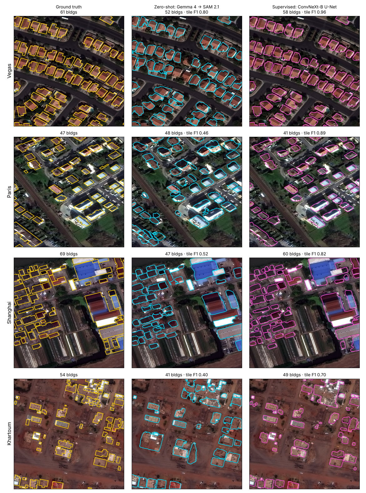

# SpaceNet 2 Speedrun — how far have we come since 2017?

Revisiting the [SpaceNet 2 building-footprint challenge](https://medium.com/the-downlinq/2nd-spacenet-competition-winners-code-release-c7473eea7c11)
(Vegas, Paris, Shanghai, Khartoum; 0.3 m WorldView-3, 650×650 tiles) with 2026 tools:

1. **Zero-shot VLMs** (Gemma 4, Qwen3-VL, Nemotron VL) through Hugging Face Inference Providers.
2. **Zero-shot SAM 2.1** (automatic masks, SigLIP2-filtered masks, VLM-box-prompted masks) on HF Jobs GPUs.
3. **A modern supervised model** (U-Net + ImageNet-21k EfficientNetV2-M, body/border/contact heads, watershed) trained on HF Jobs, to see whether we can beat the 2017 winner.

## TL;DR — yes, we win now

| Approach (2026) | Training data | Overall F1 | vs 2017 winner (0.693) | Cost |
|---|---|---|---|---|
| **ConvNeXt-B (IN-22k) U-Net, RGB only, 1 model, 53 min on 1×A100** | SN2 train | **0.755** | **+0.062, wins all 4 cities** | ~$2.20 |
| EffNetV2-M (IN-21k) U-Net, RGB only, 1 model, 56 min on 1×A100 | SN2 train | 0.731 | +0.038 | ~$2.35 |
| Ensemble of both | SN2 train | 0.752 | +0.059 | +$0.45 |
| Gemma 4 31B (2×2 crops) boxes → SAM 2.1 | **none (zero-shot)** | 0.462 | −0.23 (≈ 2/3 of winner) | ~$0.05 API + GPU |
| Gemma 4 26B-A4B boxes alone | none | 0.155 | | $0.01 |



*Left: ground truth. Middle: fully zero-shot Gemma 4 → SAM 2.1. Right: supervised ConvNeXt-B U-Net. One val tile per city.*

## Target to beat (2017 final leaderboard, F1 @ IoU ≥ 0.5)

| Entry | Vegas | Paris | Shanghai | Khartoum | **Overall** |
|---|---|---|---|---|---|
| XD_XD (1st; 3× U-Net ensemble, 8-band MS + OpenStreetMap) | 0.885 | 0.745 | 0.597 | 0.544 | **0.693** |
| wleite (2nd) | | | | | 0.643 |
| nofto (3rd) | | | | | 0.579 |

Source: DeepGlobe 2018 paper, Table 2 ([arXiv:1805.06561](https://arxiv.org/abs/1805.06561)); SpaceNet paper ([arXiv:1807.01232](https://arxiv.org/abs/1807.01232)).

## Evaluation protocol

* The official test labels were never released, so everything is scored on a **held-out 10 % of the public training tiles**
  (deterministic MD5 split, `val` = 1,037 tiles). Supervised post-processing thresholds are tuned on a separate 5 % `tune`
  split carved out of train; the model never sees `val`.
* Expensive zero-shot models are scored on **`eval_small`**: a fixed random 25 val tiles per city (100 tiles, 1,649 buildings).
* Metric (`sn2/metric.py`): one-to-one greedy matching at IoU ≥ 0.5, F1 accumulated per city, overall = mean of the 4 city F1s
  (same as the 2017 leaderboard). Polygons < 20 px² are ignored on both sides. Sanity check: GT → rasterised masks →
  our watershed post-processing → polygons scores 0.998.
* Inputs: PS-RGB (pan-sharpened RGB) only, stretched to 8-bit with a fixed per-city 1–99 % percentile stretch.
  (The 2017 winner used 8-band multispectral + OSM, so RGB-only is a handicap for us.)

## Results

### Zero-shot VLMs (eval_small: 100 val tiles, 1,649 buildings; F1 @ IoU ≥ 0.5)

Prompt: "Detect EVERY building footprint … return JSON `box_2d` normalized 0–1000". Each model is scored with whichever box
axis order it actually emits (Gemma: `[y0,x0,y1,x1]`; Qwen3-VL/Nemotron: `[x0,y0,x1,y1]`). "2×2" = the tile is split into
4 crops, each upsampled to 650 px and queried separately.

| Model (HF Inference Providers) | Output | Vegas | Paris | Shanghai | Khartoum | **Overall** | API cost |
|---|---|---|---|---|---|---|---|
| google/gemma-4-31B-it | boxes, 2×2 crops | 0.487 | 0.138 | 0.240 | 0.252 | **0.279** | $0.04 |
| google/gemma-4-26B-A4B-it | boxes, 2×2 crops | 0.424 | 0.080 | 0.200 | 0.213 | **0.229** | $0.03 |
| google/gemma-4-26B-A4B-it | boxes | 0.271 | 0.033 | 0.160 | 0.154 | 0.155 | $0.01 |
| google/gemma-4-31B-it | boxes | 0.247 | 0.045 | 0.124 | 0.158 | 0.143 | $0.01 |
| Qwen/Qwen3-VL-235B-A22B-Instruct | boxes | 0.152 | 0.018 | 0.075 | 0.119 | 0.091 | $0.27 |
| nvidia/Nemotron-3.5-Super-VL-120B-A12B | boxes | 0.093 | 0.065 | 0.086 | 0.109 | 0.088 | $0.16 |
| google/gemma-4-31B-it | polygons | 0.000 | 0.008 | 0.008 | 0.000 | 0.004 | $0.03 |

### Zero-shot SAM 2.1 (hiera-large, tile upsampled 2×; same 100 tiles)

| Pipeline | Vegas | Paris | Shanghai | Khartoum | **Overall** |
|---|---|---|---|---|---|
| *Oracle: ground-truth boxes → SAM 2.1* | *0.982* | *0.956* | *0.973* | *0.967* | ***0.970*** |
| **Gemma 4 31B boxes (2×2 crops) → SAM 2.1** | 0.639 | 0.425 | 0.381 | 0.403 | **0.462** |
| Gemma 4 26B boxes (2×2 crops) → SAM 2.1 | 0.600 | 0.433 | 0.395 | 0.364 | 0.448 |
| Gemma 4 26B boxes → SAM 2.1 | 0.576 | 0.355 | 0.377 | 0.302 | 0.403 |
| Gemma 4 31B boxes → SAM 2.1 | 0.554 | 0.260 | 0.337 | 0.339 | 0.373 |
| SAM 2.1 automatic masks + SigLIP2 zero-shot "building roof" filter | 0.438 | 0.287 | 0.275 | 0.297 | 0.324 |
| SAM 2.1 automatic masks (everything) | 0.196 | 0.135 | 0.149 | 0.161 | 0.160 |

Takeaways:
* **SAM's masks are essentially solved**: given perfect boxes it scores 0.97. The bottleneck is *recognition* — finding every building.
* VLMs alone can't produce footprints (boxes too loose for IoU ≥ 0.5, polygons are nonsense), but their boxes make excellent
  SAM prompts: **VLM → SAM is a 0.46 fully zero-shot pipeline** — ~2/3 of the 2017 winner with zero SpaceNet training data,
  for a few cents of API calls. Cropping (more pixels per building) is the biggest single lever for the VLMs.
* Recall is the limiter (Gemma finds ~50–60 % of buildings, under-counting dense blocks).

### Supervised (full held-out `val`: 1,037 tiles, 20,859 buildings)

Recipe (`jobs/train_seg.py`): U-Net (segmentation_models_pytorch) with a timm ImageNet-21k/22k encoder; 3 sigmoid outputs
(building body, 2-px border, building-building contact) trained with weighted BCE + Dice; images upsampled 1.5× (0.2 m/px);
random 512 px crops with scale jitter, flips/rot90, photometric jitter; AdamW, cosine LR, bf16, 20k steps × batch 12
(≈ 25 epochs). Inference: 4-way flip/transpose TTA, marker-controlled watershed (seeds = body·(1−border)·(1−contact)),
`approxPolyDP` polygons. Watershed thresholds tuned on the separate `tune` split.

| Model | Vegas | Paris | Shanghai | Khartoum | **Overall** |
|---|---|---|---|---|---|
| XD_XD — 2017 winner (8-band MS + OSM, 3-model ensemble; official test set) | 0.885 | 0.745 | 0.597 | 0.544 | 0.693 |
| **ConvNeXt-B U-Net (RGB only)** | **0.892** | **0.807** | **0.709** | 0.611 | **0.755** |
| EffNetV2-M U-Net (RGB only) | 0.878 | 0.768 | 0.691 | 0.586 | 0.731 |
| Ensemble (mean of both; wider pp grid) | 0.890 | 0.800 | 0.706 | **0.612** | 0.752 |

Biggest gains are in the hard cities (Shanghai +0.11, Khartoum +0.07, Paris +0.06); Vegas was already near saturation in 2017.
Caveat: our `val` is a held-out slice of the public training AOIs, not the (unreleased) official test set, so numbers are
comparable but not identical to the leaderboard. Precision/recall per city are in `results/supervised/*.json`.

## Layout

```
sn2/metric.py              SpaceNet F1 scorer (+ CSV IO)
sn2/vlm.py                 HF router client, prompts, box/polygon parsing
scripts/prepare_dataset.py S3 → 8-bit PNG tiles, labels, splits (train/val/eval_small)
scripts/make_shards.py     per-city uint8 .npy shards for fast loading in Jobs
scripts/eval_vlm.py        zero-shot VLM benchmark (cached raw responses in results/raw/)
scripts/export_prompts.py  VLM boxes → SAM box prompts
jobs/sam_eval.py           HF Jobs (GPU): SAM 2.1 AMG / AMG+SigLIP2 / box-prompted SAM
jobs/train_seg.py          HF Jobs (GPU): supervised U-Net training + tuned watershed + val scoring
results/                   JSON results, raw VLM outputs, SAM prompts
```

Data and job outputs live on the Hub (private): dataset `Rootkit29/spacenet2-speedrun` (tiles, labels, splits, shards)
and bucket `Rootkit29/sn2-runs` (checkpoints, predictions). Jobs mount both as volumes, so no token is needed inside the job:

```bash
hf jobs uv run --flavor a100-large --timeout 5h -d \
  -v hf://datasets/Rootkit29/spacenet2-speedrun:/sn2 -v hf://buckets/Rootkit29/sn2-runs:/out \
  jobs/train_seg.py --run effv2m_unet_20k --steps 20000 --bs 12 --crop 512
hf jobs uv run --flavor a100-large --timeout 90m -d \
  -v hf://datasets/Rootkit29/spacenet2-speedrun:/sn2 -v hf://buckets/Rootkit29/sn2-runs:/out \
  jobs/sam_eval.py --variants amg_all,amg_siglip,box:gt,box:gemma4_26b_g1
```

## Compute & cost

Everything ran on Hugging Face: Inference Providers for VLMs (~$0.70 total) and HF Jobs (1×A100-80GB, $2.50/h) for SAM and
training (~2.8 GPU-hours incl. a smoke test and a billing-interrupted SAM run, ≈ $7). Total ≈ $8.

## Ideas not tried (yet)

* SAM 3 (text-prompted "building" segmentation) — gated model; needs access approval on the Hub.
* 8-band multispectral input, larger crops / longer schedules, more ensemble members, multi-scale TTA.
* Fine-tuning SAM 2.1 / a satellite-pretrained ViT backbone; using the supervised model's boxes as SAM prompts.
